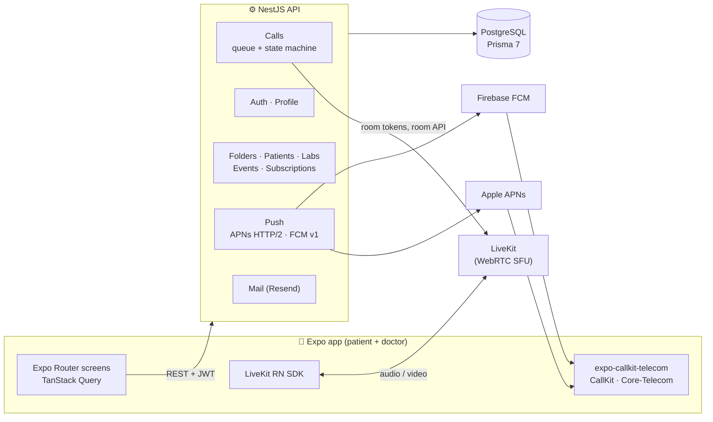
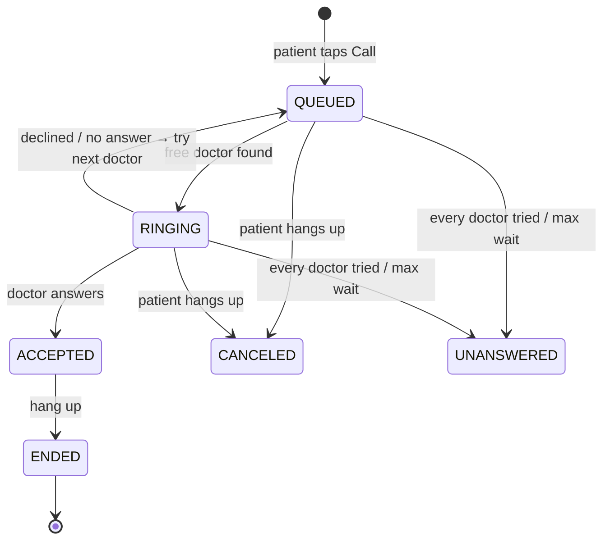

<div align="center">

# 🩺 Telehealth

### See a doctor in one tap, at any hour, by voice or video.

A full-stack telemedicine platform: a **React Native app for both patients and doctors**, a **NestJS + PostgreSQL backend**, and **real-time WebRTC calls** that ring a doctor's phone like a normal phone call, even when the app is closed and the screen is locked.


**iOS · Android · 🇦🇱 Albanian · 🇬🇧 English · 🇲🇰 Macedonian**

</div>

---

## 🎬 Demo

### 👤 Patient experience

Onboarding, the home feed and stories, the health card, lab results, medical folders, and calling a doctor with one tap.

https://github.com/user-attachments/assets/b63827b1-70d8-4a84-a0c8-295c4c8966b6

### 📹 Live video call test

A real call between two phones: the patient taps Call, the doctor's phone rings through the native call screen, the doctor answers, and both sides talk over live video.

[CALL_VIDEO_URL](https://github.com/user-attachments/assets/473572e4-add8-49f9-b128-2f60fb64903e)

---

## 📌 At a glance

| | |
|---|---|
| **Apps** | One mobile app with separate patient and doctor experiences, plus a REST API |
| **Codebase** | ~19,000 lines of TypeScript in a pnpm + Turborepo monorepo |
| **Backend** | 20 NestJS modules, 64 REST endpoints with Swagger docs, 24 Prisma models, 7 SQL migrations |
| **Calling** | LiveKit (WebRTC) audio/video, a server-side call queue, native CallKit (iOS) and Core-Telecom (Android) ringing |
| **Push** | APNs (VoIP + alerts) and Firebase Cloud Messaging clients written from scratch over HTTP/2 |
| **Languages** | Full UI, push notifications, emails and server pages in 3 languages, with type-checked translations |

---

## ✨ Features

### 👤 For patients

- **One-tap doctor call.** A single large button starts a video or voice-only call. The patient doesn't have to pick a doctor: the system finds the first free one.
- **Live queue experience.** The waiting screen shows *"N people ahead"*, *"Calling…"* or *"Trying another line…"* as the call moves through the queue, with a dial tone on the phone's native call screen.
- **In-call experience.** Full-screen video tiles for every participant, a picture-in-picture self view, mute, speaker and front/back camera controls, and a **post-call rating** with comments.
- **Digital health card.** A gold, bank-card-sized (ISO/IEC 7810 ID-1) card with a 3D look built from layered gradients and shadows that **tilts toward your finger** as you touch it.
- **Lab results.** The latest blood and urine tests, each value drawn on its own scale of dots coloured by the lab's reference ranges (low, normal, borderline, high).
- **Medical folders.** Visit records written by doctors: symptoms, diagnosis, prescription and recommendations, with comment threads and attached documents (images, PDFs). Any folder can be **exported to PDF and shared**.
- **Subscriptions, three ways.** Activate with an **insurance policy** (policy type + card number), a **prepaid code**, or a demo plan. Insurance **claims** and their status (submitted, in review, approved, rejected, paid) are listed next to the health card.
- **Activities.** Scheduled sessions with specialists, with limited seats. Patients join or leave, and during a **live** session they can request a call straight to that specialist.
- **Home feed.** Instagram-style **stories** (full screen, auto-advancing with progress bars, tap or swipe to move), **"My benefits"** promotions, and health **articles** with read times.
- **Notifications centre.** Folder updates, new comments, documents, joined events and announcements. Tapping one opens what it's about. When a doctor offers a **free line**, the notification has a **"Call now"** button that rings that doctor first.
- **Profile.** Edit personal details and photo, change password, call assistance, and the partner clinic network in an in-app browser.

### 🩺 For doctors

- **Native incoming calls.** The phone rings through **CallKit / Core-Telecom** even when the app is closed or the phone is locked. While the app is open, a full-screen invitation also shows the patient's name and plan.
- **Add a doctor.** During a call, bring another free doctor into the same room for a second opinion. They're rung exactly like a normal call.
- **"Free line".** After a call, a doctor can tell a patient they're available, sending a push with a "Call now" shortcut.
- **Patient list.** Search by name, email, phone or national ID. Open a patient to see their details and medical folders, or **write a new visit record** (the patient is notified).
- **Temporary block.** Stop a patient from calling for a set number of hours, with a reason, and lift it any time.
- **Dashboard.** A live "ready for calls" indicator (a pulsing dot), today's numbers, full call history, and a professional profile (specialty, bio, licence, health centre).

### 🔐 Accounts and security

- **Two-step onboarding:** the email decides whether you log in or sign up.
- **Sign-up with email confirmation**, and **"forgot password" with a 6-digit emailed code**.
- **Face ID / Touch ID / fingerprint login.** The API issues a long-lived key that the phone keeps behind the device's biometric lock.
- **Argon2** password hashing. One-time codes and biometric keys are stored only as **SHA-256 hashes**, with attempt limits and expiry.
- **JWT auth** stored in the device's secure enclave (SecureStore), readable after first unlock so a doctor can answer on the lock screen.
- **Care-based access control.** A doctor can only see a patient after answering their call, being added to it, or writing them a folder. Anything else is a 404, not a 403, so records can't be discovered.
- **Privacy by design.** Pushes carry only IDs, never names or health data. LiveKit tokens contain only a user ID, are scoped to one room and expire in 10 minutes.

### 🌍 Internationalisation

- Albanian (default), English and Macedonian, chosen on first launch and switchable at any time.
- Translations are **type-checked**: a missing key in any language fails the TypeScript build.
- Correct plural rules per language (including Macedonian's), and hand-written date formatting.
- The server also localises content, push notifications, emails and web pages, using each user's saved language.

### 🎨 Design system

- Design tokens (teal brand, accent palette, type scale, radii, shadows) in one theme file.
- A reusable component library: `Button`, `Card`, `Screen`, `Header`, `TextField`, `ListGroup`/`ListRow`, `Badge`, `Avatar`, bottom `Sheet` + action sheets, snackbars, and loading skeletons and empty/error states.
- Haptics, pull-to-refresh, animated ringing rings around the caller's avatar, and a custom tab bar with a raised centre call button.

---

## 🏗️ Architecture



- **The API is the control plane.** It owns call state, routing, eligibility and access rules. LiveKit only carries the media.
- **One LiveKit room per call** (`call-<id>`). The patient gets a token when the call is created and waits in the room; a doctor gets one only after accepting. Ending the call deletes the room, which disconnects everyone at once.
- **Vendor-portable.** The same code works with LiveKit Cloud or a self-hosted LiveKit server, so media can be kept in-country by changing three environment variables.

### 📞 The call engine

Calls are a **queue plus a state machine**. Every ring of a doctor's phone is recorded as a `CallAttempt`, so if a doctor declines or doesn't answer, the call goes back to the queue and the next free doctor is tried.



**Engineering highlights:**

- **Race-free by construction.** Every transition is a conditional `UPDATE … WHERE state = <expected>`, so two doctors answering at the same moment can't both win.
- **Invariants enforced by the database.** Hand-written **partial unique indexes** guarantee one active call per patient, one active call per doctor, and one active invite per doctor (constraints Prisma can't express on its own).
- **No background workers needed.** The queue advances on incoming requests (expire, then dispatch, one run at a time), kept moving by the waiting patient's poll.
- **Reachability-aware routing.** Only doctors who can actually ring are tried: those with a registered push device, or whose app checked in within the last 30 seconds. Preferred doctors (a "free line" or a live event's specialist) are rung first.
- **Timeouts kept in agreement** across the server (`CALL_RING_SECONDS`, `CALL_MAX_WAIT_SECONDS`) and the phone's native call timeouts, so neither side gives up early.
- **Native audio done right.** `expo-callkit-telecom` owns the audio session; LiveKit's audio engine is switched on and off from CallKit's audio-session events, so calls answered from the lock screen get working audio.
- **Push clients from scratch.** APNs over HTTP/2 with `.p8` token auth (VoIP + alert pushes) and FCM HTTP v1 with service-account OAuth, with payloads shaped for native parsing before any JavaScript runs.

---

## 🧰 Tech stack

| Layer | Technologies |
|---|---|
| **Mobile** | React Native 0.86 (New Architecture), Expo SDK 57, Expo Router (typed file-based routing, role-protected stacks), TanStack Query, React Hook Form + Zod, LiveKit React Native SDK, `expo-callkit-telecom`, expo-notifications, expo-local-authentication, expo-secure-store, expo-print, expo-image-picker, expo-document-picker, expo-linear-gradient, WebView |
| **Backend** | NestJS 12, Prisma 7 (driver adapter `pg`), PostgreSQL, class-validator DTOs, Swagger / OpenAPI, `@nestjs/jwt`, Argon2, LiveKit server SDK, Resend (email) |
| **Real-time & push** | LiveKit (WebRTC SFU), Apple APNs (PushKit VoIP + alerts), Firebase Cloud Messaging v1 |
| **Tooling** | TypeScript 6 (strict) everywhere, pnpm workspaces, Turborepo, EAS Build, tsc-watch |

---

## 🗂️ Data model

24 Prisma models across six domains, all with UUID v7 keys:

| Domain | Models |
|---|---|
| **Identity** | `User` (patient / doctor), `DoctorProfile`, `AuthToken` (email verification, password reset, biometric), `Device` (VoIP / APNs / FCM tokens) |
| **Calls** | `Call`, `CallAttempt` (each ring), `CallInvite` ("add doctor"), `CallFeedback` |
| **Medical** | `MedicalFolder` (with concern categories and doctor-only notes), `FolderComment`, `FolderDocument`, `PatientBlock`, `LabReport`, `LabResult` (with reference ranges) |
| **Insurance** | `Subscription`, `InsurancePolicy`, `PrepaidCard`, `Claim` (money as `Decimal(18,2)` + currency) |
| **Engagement** | `Event`, `EventParticipant`, `Notification` (typed, rendered per language from templates) |
| **Content** | `Story`, `Benefit`, `Article` (texts stored as `{ sq, en, mk }` JSON) |

---

## 🔌 API overview

All routes are under `/api`, validated with whitelisted DTOs, and documented in **Swagger at `/api/docs`**. Errors the app reacts to have stable codes (`SUBSCRIPTION_REQUIRED`, `PATIENT_BLOCKED`, `EVENT_FULL`, `NO_DOCTOR_AVAILABLE`, …) that the app translates.

| Group | Endpoints |
|---|---|
| `auth` | check email, login, register, verify email, resend verification, forgot password, verify reset code, reset password, change password, biometric key create / revoke / login, `me` |
| `calls` | create, list, incoming, available doctors, detail, accept, decline, end, invite doctor, feedback, free line |
| `folders` | list, create, detail, comments, documents (upload + authenticated download) |
| `patients` | list, detail, block, unblock |
| `subscription` | status, activate via insurance / prepaid / demo, claims |
| `events` | list, detail, join, leave |
| `notifications` | list, unread, mark one / all read |
| other | profile + avatar, devices, doctors, lab reports, stories, benefits, articles, app config, partner page |

---

## 📁 Project structure

```
telehealth/
├── apps/
│   ├── api/                    NestJS backend
│   │   ├── prisma/             schema, migrations, demo seed
│   │   └── src/
│   │       ├── auth/           login, sign-up, reset codes, biometric keys, JWT guard
│   │       ├── calls/          queue + state machine
│   │       ├── livekit/        room tokens and room API
│   │       ├── push/           APNs (HTTP/2) and FCM v1 clients
│   │       ├── care/           who-can-see-whom rules
│   │       ├── folders/  patients/  lab-reports/  events/
│   │       ├── subscriptions/  notifications/  content/  mail/  files/
│   │       └── common/         errors, language, shared helpers
│   └── mobile/                 Expo app
│       └── src/
│           ├── app/            Expo Router screens: (auth), patient/, doctor/, shared
│           ├── calls/          CallCoordinator, useCall, audio engine
│           ├── components/     design system (ui/) and feature components
│           ├── i18n/           sq / en / mk dictionaries, plurals, dates
│           ├── api/            typed client, endpoints, queries
│           └── auth/  notifications/  documents/
└── docs/
    ├── ARCHITECTURE.md         the long-term target architecture
    └── CALLS_SETUP.md          LiveKit, APNs and FCM setup
```

---

## 🚀 Getting started

### Requirements

- **Node.js 22+** and **pnpm** (the version is pinned in `package.json`; `corepack enable` picks it up)
- **PostgreSQL** running locally on port 5432
- A free **[LiveKit Cloud](https://cloud.livekit.io)** project for calls
- The Telehealth **development build** on your phone. Expo Go can't run the app, because calls need native code.

### Setup

```sh
pnpm install

# Fill in your Postgres password, a random JWT secret and your LiveKit URL, key and secret
# (plus the optional APNs / FCM keys, see docs/CALLS_SETUP.md)
cp apps/api/.env.example apps/api/.env

pnpm db:migrate   # creates the "telehealth" database and its tables
pnpm db:seed      # demo accounts and content (re-running it resets the demo data)
```

### Run

```sh
pnpm dev:api      # API on http://localhost:3000 · Swagger at http://localhost:3000/api/docs
pnpm dev:mobile   # Expo dev server; open it from the Telehealth development build
```

- The phone must be on the **same network** as your computer. The app automatically talks to the API on the machine running the Expo dev server; set `EXPO_PUBLIC_API_URL` in `apps/mobile/.env` to use another one.
- On Windows, allow **Node.js** through the firewall for private networks (port 3000) if the phone can't reach the API.
- Emails (confirmation links, reset codes) are written to the API log until `RESEND_API_KEY` is set.

### Development build

Needed once, and again whenever native code changes:

```sh
cd apps/mobile
npx eas-cli@latest login
npx eas-cli@latest device:create    # iPhone only: registers the phone
npx eas-cli@latest build --platform ios --profile development
npx eas-cli@latest build --platform android --profile development
```

An iPhone build needs a paid Apple Developer account and **Developer Mode** turned on. Testing with a free Apple ID, and step-by-step LiveKit, APNs and Firebase setup, are covered in **[docs/CALLS_SETUP.md](docs/CALLS_SETUP.md)**.

### Demo accounts

Password **`1234`** for all:

| Email | Role | What to try |
|---|---|---|
| `patient@telehealth.al` | Patient | Active Premium plan, folders, claims, lab results, call history |
| `arta@telehealth.al` | Patient | No subscription: try activating one |
| `elton@telehealth.al` | Patient | Blocked from calling for 2 days |
| `doktor@telehealth.al` | Doctor | Specialist of the live activity |
| `drita@` · `besnik@` · `elena@telehealth.al` | Doctors | For the queue and "Add doctor" |

To activate a subscription: insurance **Shëndetësore `4021883011230059`** or **Familjare `5100200030004000`**, or the prepaid codes **`TH-30-DEMO`** / **`TH-90-DEMO`**.

**Trying a call:** log in as `doktor@telehealth.al` on one phone and `patient@telehealth.al` on another, then tap the big **Thirr** (Call) button. With a single phone, you can play the patient from a browser using Swagger and [meet.livekit.io](https://meet.livekit.io), as described in [docs/CALLS_SETUP.md](docs/CALLS_SETUP.md).

### Useful commands

```sh
pnpm typecheck                      # typecheck both apps
pnpm build                          # build the API
pnpm --filter api prisma:migrate    # after changing apps/api/prisma/schema.prisma
```

---

## 🧭 Roadmap

The target design is in **[docs/ARCHITECTURE.md](docs/ARCHITECTURE.md)**. Next steps include:

- [ ] **Admin web** (Vite + React) for insurers to manage policies, coverages, doctors and content
- [ ] **Coverage-based eligibility engine**: what each patient can use depends on their policy's coverages and limits
- [ ] **Personal doctors, care teams and on-call shifts** for smarter 24/7 routing, with callback requests as a fallback
- [ ] **Socket.IO + LiveKit webhooks** to replace polling for call state
- [ ] **Phone-number dial-in** through LiveKit SIP
- [ ] Rotating refresh tokens, TOTP for doctors and staff, an audit log of every access to health data
- [ ] Automated tests and CI on GitHub Actions

---

<details>
<summary><b>Troubleshooting</b></summary>

- If `corepack enable` / `pnpm` fails with `Cannot find matching keyid`, your corepack is too old to verify pnpm's signature. Update it (`npm install -g corepack@latest`) or run the pinned pnpm directly: `npx pnpm@12.6.0 install`.
- The API compiles with plain `tsc` (and `tsc-watch` in dev) instead of the Nest CLI, because the Nest 12 CLI crashes on Node 22.13 (`ERR_REQUIRE_CYCLE_MODULE`).
- The partner clinic page and the seeded policies, codes, stories, benefits, articles and activities are sample data until the admin web exists.

</details>
